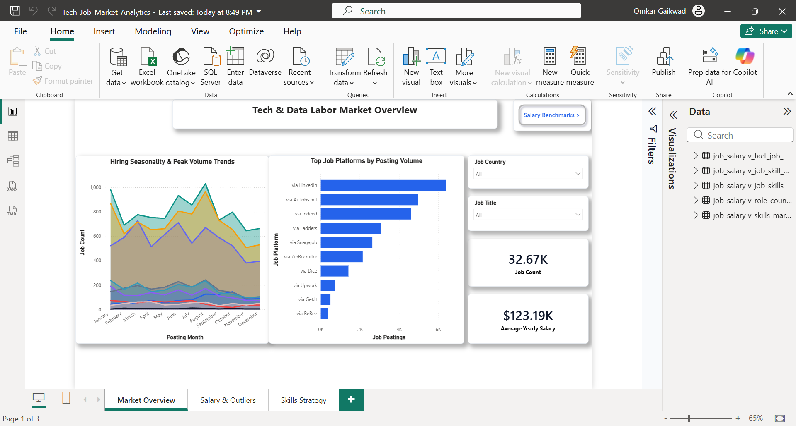
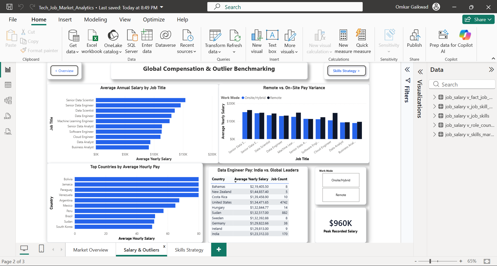
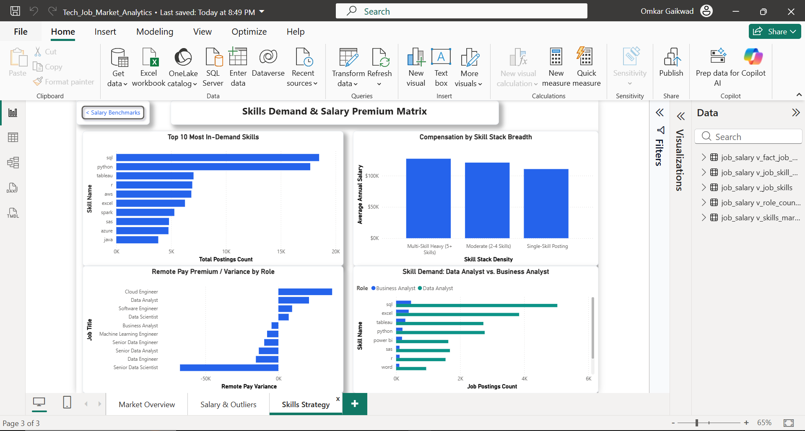

# 📊 Global Tech & Data Job Market Intelligence: SQL & Power BI Portfolio Project

An end-to-end data analytics project combining relational data modeling in **MySQL** with an interactive 3-page executive reporting dashboard in **Microsoft Power BI**.

This project explores 32,000+ job postings across global markets to evaluate salary dynamics, remote compensation differences, hiring seasonality, and skill premiums.

---

## 🔗 Live Interactive Report

👉 \*_[Click Here to Open the Live Interactive Dashboard](https://app.powerbi.com/view?r=eyJrIjoiYmY2Nzc4ZWEtNDVjMS00N2Q3LWE1OWQtN2FiNjQ2NTk1NTJjIiwidCI6IjBhMGFhNjNkLTgyZDAtNGJhMS1iOTA5LWQ3OTg2ZWNlNGM0YyJ9)
_(No Microsoft sign-in or Power BI installation required — fully interactable via web browser).\*

---

## 📌 Executive Summary & Business Problems Solved

Job seekers, hiring managers, and HR organizations often make decisions based on generic national averages. This project translates raw posting records into strategic labor market intelligence by answering:

1. **Hiring Seasonality:** What months represent the peak hiring surges for Data Analysts, Data Scientists, and Data Engineers?
2. **Platform Efficiency:** Which hiring portals dominate job hunting volume regionally vs. globally?
3. **Outlier Skew (Mean vs. Median):** Are reported averages misleadingly inflated by extreme executive/niche outliers?
4. **Remote vs. On-site Dynamics:** Does remote work pay a premium or a penalty across different titles?
5. **Skill ROI & Market Supply:** Which foundational tools provide volume security (liquidity) vs. which rare tools command salary premiums?

---

## 🛠️ Architecture & Tech Stack


- **Database Engine:** MySQL 8.0 (MySQL Workbench CE)
- **Data Transformation:** SQL Views (`v_fact_job_postings`, `v_job_skills`, `v_job_skill_density`, `v_role_country_salaries`, `v_skills_market_benchmark`)
- **SQL Techniques:** Multi-CTE pipelines, Window Functions (`ROW_NUMBER() OVER PARTITION BY`), Conditional Aggregations (`CASE WHEN`), Subqueries, and Set Operations (`UNION`).
- **BI Platform:** Microsoft Power BI Desktop & Power BI Service
- **Data Modeling:** Relational Star Schema (1-to-many relationship on `job_id`)
- **UX/UI:** Custom corporate theme, KPI cards, synchronized slicers, and button-driven sequential page navigation.

---

## 💡 Key Business Insights Discovered

### 1. Hiring Waves Are Highly Seasonal (Q1 & Q3 Surges)

- **August** is the global peak hiring month for **Data Analyst** and **Data Scientist** positions.
- **March** is the secondary surge window, driven primarily by corporate **Data Engineer** headcount openings.

### 2. Platform Dominance Shifts by Region

- **LinkedIn** is the #1 job board globally and in the US, accounting for the highest volume of postings.
- In international tech hubs like **India, the UK, and Germany**, specialized platforms like **Ai-Jobs.net** and **Indeed** capture substantial market share.

### 3. Outlier Distortion (Why Median Salary Matters)

- For roles like **Senior Data Scientist** and **Senior Data Engineer**, the mean and median salaries align within 1–2% (indicating a normal distribution).
- For **Machine Learning Engineer**, **Software Engineer**, and **Cloud Engineer**, the average is inflated by **$14,000 to $21,000** over the median due to extreme high-salary outliers.

### 4. Remote Pay Variance Differs by Discipline

- **Data Analysts:** Only **13.2%** of US postings are remote, and on-site roles pay higher average salaries than remote counterparts.
- **Business Analysts:** **15.7%** of postings are remote, and remote roles pay an average salary premium over on-site positions.

### 5. Skill Value: Foundational Security vs. Scarcity Premium

- **High Liquidity Baseline:** **SQL** (14,000+ mentions) and **Python** (12,000+ mentions) represent the non-negotiable core skill baseline across all analytical tracks.
- **Scarcity Premium:** Niche specialized tools with small talent pools command substantial compensation premiums:
  - `dplyr` (N = 19): **$160,667** average salary
  - `Solidity` (N = 10): **$153,640** average salary
  - `Spark` (N = 4,010): **$141,500** average salary

---

## 📸 Dashboard Showcase

### Page 1: Market & Hiring Overview

_Executive KPIs (32.67K total postings, $123.19K avg pay), Monthly seasonality curves, Top 10 hiring platforms, and synchronized Country & Role slicers._



---

### Page 2: Global Compensation & Outlier Benchmarking

_Salary distribution by role, Remote vs. on-site variance, Top 10 hourly paying countries, Data Engineer global benchmark table (India vs. top 9 global markets), and peak recorded salary card ($960K)._



---

### Page 3: Skills Strategy & Career Matrix

_Top 10 in-demand skills, salary impact by skill stack breadth (single vs. multi-skill), remote pay premium/variance by title, and side-by-side skill requirements for Data Analysts vs. Business Analysts._



---

## 📁 Repository Structure

```text
├── 01_database_views.sql              # Production SQL views preparing the Star Schema for Power BI
├── original_analytical_queries.sql    # Complete SQL script containing all 13 analytical business queries
├── Tech_Job_Market_Analytics.pbix     # Complete Power BI Desktop report file (3-page dashboard)
├── corporate_theme.json               # Custom Power BI corporate theme specification
├── screenshots/                       # High-resolution screenshots of the 3 dashboard pages
│   ├── page1_market_overview.png
│   ├── page2_salary_outliers.png
│   └── page3_skills_strategy.png
└── README.md                          # Project documentation and business insights
```

---

## 🚀 How to Replicate Locally

1. **Database Setup:**
   - Open **MySQL Workbench**.
   - Run your base data ingestion, then execute `01_database_views.sql` to generate the 5 relational views.
2. **Power BI Connection:**
   - Open **Power BI Desktop**.
   - Click **Get Data** → **MySQL Database** (`Server: localhost`, `Database: job_salary`).
   - Select `v_fact_job_postings`, `v_job_skills`, `v_job_skill_density`, `v_role_country_salaries`, and `v_skills_market_benchmark`.
3. **Open the Report:**
   - Alternatively, double-click `Tech_Job_Market_Analytics.pbix` directly to explore the pre-built visual models, DAX formulas, and page navigation structure.
